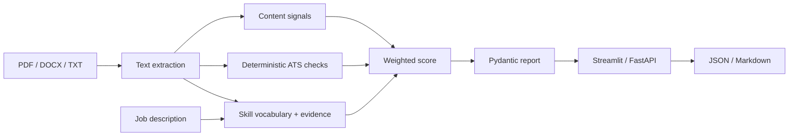

# CV Optimiser

**An explainable CV-to-job analyser built with Python, FastAPI, and Streamlit.**

CV Optimiser compares a CV with a job description and returns a structured,
ATS-aware report. The first version works locally without an API key; adding an
OpenAI key enables richer summary and bullet rewrites.

## Features

- PDF, DOCX, and TXT parsing
- Weighted skill coverage with canonical names and aliases (e.g. Postgres → PostgreSQL)
- Required versus preferred skill weighting
- CV evidence attached to every matched skill
- Strong and missing skills
- Deterministic ATS checks
- Suggested CV section order and projects to highlight
- Optional LLM-generated summary and bullet rewrites
- Streamlit UI and FastAPI endpoint
- One-click sample demo, without an API key
- JSON and readable Markdown report downloads
- Automated CI on Python 3.10 and 3.12

## Quick start

```bash
python3 -m venv .venv
source .venv/bin/activate
python -m pip install -r requirements.txt
cp .env.example .env
python -m streamlit run app.py
```

The UI opens at `http://localhost:8501`.
Select **Try the sample CV & job** to explore a complete report immediately.
Use Python 3.10+ for new environments. The existing local Python 3.9 environment
is also supported by the current code.

Running `streamlit run src/app.py` is also supported.

To run the API instead:

```bash
uvicorn src.api:app --reload
```

Then open `http://localhost:8000/docs`. The `POST /analyse` endpoint accepts
`cv_file` plus either `job_text` or `job_file`.

## Tests

```bash
python -m pytest -q
```

## Architecture



The local analyser is intentionally deterministic and explainable. The LLM is
used only to enrich writing suggestions and must return validated JSON.

## How scoring works

The overall score is **60% skill coverage + 25% ATS checks + 15% content signals**.
Skills mentioned in the job description are matched against a curated vocabulary
in `src/skills.py`. Matching is case insensitive, recognises aliases, and uses
word boundaries to avoid matching Java inside JavaScript. Required skills carry
weight 2; skills under a recognised preferred heading carry weight 1. If a skill
appears in both, it is treated as required. Repetition does not increase weight.

Each matched skill includes the first CV line containing it. A mention demonstrates
textual coverage, not proficiency. ATS checks inspect contact details, section
headings, word count, and PDF page count. Content signals count bullet points,
action verbs, and metrics. This is an editing aid, **not a hiring prediction or
an ATS vendor score**.

## Project structure

```text
app.py                 Streamlit entry point
src/
  api.py               FastAPI endpoints
  app.py               Interactive report UI
  analyzer.py          Analysis orchestration and fallback
  skills.py            Skill vocabulary, aliases, evidence, weighting
  ats.py               Deterministic document checks
  scoring.py           Scoring utilities
  parser.py            Document extraction
  models.py            Validated report contracts
  llm.py / prompts.py  Optional writing enhancement
  reports.py           Markdown export
sample_data/           Fictional CV and target job
tests/                 Unit, API, and Streamlit interaction tests
.github/workflows/     CI across supported Python versions
```

## API example

```bash
curl -X POST http://localhost:8000/analyse \
  -F 'cv_file=@sample_data/Alex_Morgan_Sample_CV.docx' \
  -F 'job_file=@sample_data/job_description.txt' \
  -F 'use_llm=false'
```

## Privacy and reliability

The app does not persist uploaded documents to a database. Documents are processed
in application memory; Streamlit session state holds the resulting report.
AI writing enhancement is opt-in in the UI. When enabled, extracted CV and job
text are sent to OpenAI; local matching and scoring need no provider calls.
If the provider fails, local analysis remains available with a visible warning.
Do not commit real CVs, secrets, or `.env` files.

## Current limitations

- The vocabulary is aimed at software and data roles; unfamiliar skills may be missed.
- Only recognised section headings identify preferred requirements; unclassified skills default to required.
- Scanned PDFs need OCR, which is not included.
- The tool does not inspect graphics, font consistency, or complex reading order.
- Local bullet suggestions are coaching prompts, not finished AI rewrites.
- Public deployment needs upload limits, authentication/rate limits, and operational monitoring.

## Run with Docker

```bash
docker build -t cv-optimiser .
docker run --rm -p 8501:8501 cv-optimiser
```

## Development roadmap

- Add OCR and document layout diagnostics.
- Expand the vocabulary with annotated evaluation examples.
- Compare CV versions against the same job description.
- Add downloadable polished reports and richer writing evaluation.

## License

This project is licensed under the [MIT License](LICENSE).
